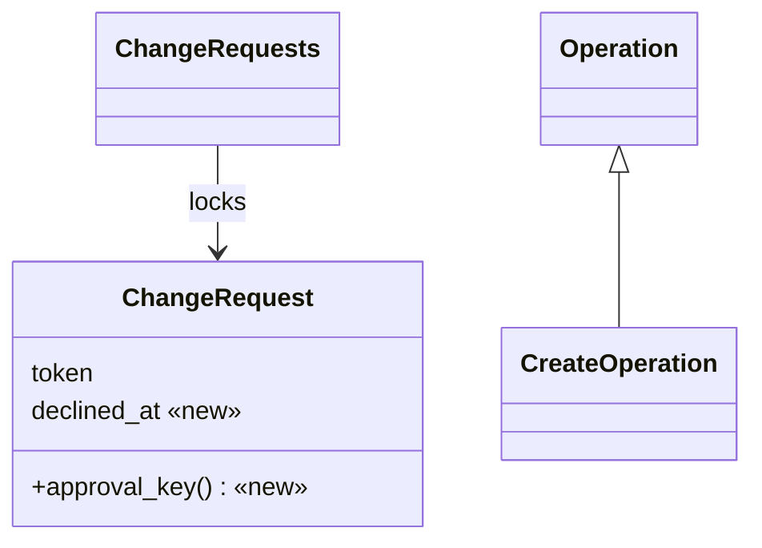
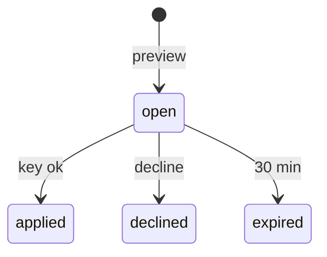
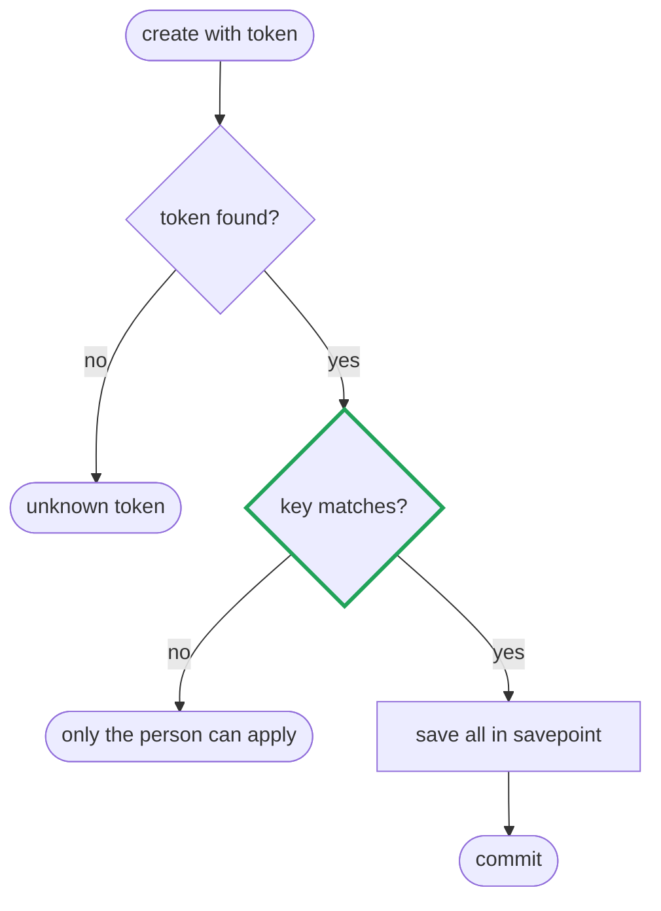

# Diagram choices

Entities in UML and algorithms as flowcharts, drawn in Mermaid; processes in BPMN, drawn by `scripts/bpmn_svg.py`. One idea per diagram, at most 8 nodes (6 for the overview), labels ≤ 5 words. Every diagram marks the delta: new, changed, removed.

## Entities — UML



- Only classes the change adds or alters, 2–4 members each. Mark `«new»`, `«changed»`, `«removed»` in member text.
- Edges labeled with a verb: uses, locks, builds, renders.



- Events on transitions. Say in the caption whether state is stored or derived.

## Algorithms — flowchart



Mark the delta with the three `classDef`s and repeat the mark in the label text («new», «changed», «removed»): color alone is not enough. Set only `stroke`, `stroke-width` and `stroke-dasharray` in a `classDef`, never `fill` or `color`: the viewer renders Mermaid in the reader's theme, and a fixed light fill under theme-colored text makes the label invisible in dark mode.

- `([ ])` start/end, `[ ]` step, `{ }` decision phrased as a question, every exit labeled.
- Merge error exits when they share a meaning; list exact error strings in the reference layer, not in the diagram.

## Processes — BPMN

Real BPMN notation drawn as inline SVG by `scripts/bpmn_svg.py` — no library, no network. Spec:

```json
{"id": "card",
 "pools": [{"id": "human", "name": "Person"}, {"id": "card", "name": "Card"}, {"id": "server", "name": "Server"}],
 "nodes": [
  {"id": "p1", "pool": "human", "type": "task", "label": "Press Create", "col": 0},
  {"id": "c1", "pool": "card", "type": "xor", "label": "Tool call allowed?", "col": 1},
  {"id": "c2", "pool": "card", "type": "task", "label": "Call create", "col": 2},
  {"id": "c3", "pool": "card", "type": "task", "label": "Put key in chat", "col": 3, "row": 1, "status": "new"},
  {"id": "s1", "pool": "server", "type": "task", "label": "Apply", "col": 2}],
 "flows": [
  {"from": "p1", "to": "c1"}, {"from": "c1", "to": "c2", "label": "yes"},
  {"from": "c1", "to": "c3", "label": "no"}, {"from": "c2", "to": "s1"}]}
```

- Types: `start`, `end`, `task`, `xor`, `catch` (message intermediate event).
- `status`: `new`, `changed` or `removed` on a node colors it and adds the text mark under it; omit for unchanged nodes.
- Pools are stacked top to bottom in spec order; `col` is shared by all pools; `row` 0 or 1 inside a pool.
- Same pool → sequence flow; different pools → message flow, drawn vertically between pools.
- Layout rules that keep lines clean: put a message flow's two ends in the same `col` when possible; never put a node on the column a message flow passes through on its way to a farther pool; a gateway's lower branch goes to `row: 1`.
- At most 3 pools and 8 nodes. Split a bigger process.
- Look at the rendered page: if a label sits on a line or a line crosses a node, move a node one column and regenerate.

## Other

| Content | Form |
| --- | --- |
| Who sees what | Small table |
| Value derivation | Flowchart: inputs → function → output |
| Rename or extraction | Two-column table |

Place each diagram right before the code it explains, with a one-sentence caption. Reuse the shared input across diagrams. Never show a possible branch as the one taken; mark an unverified transition in its label.
